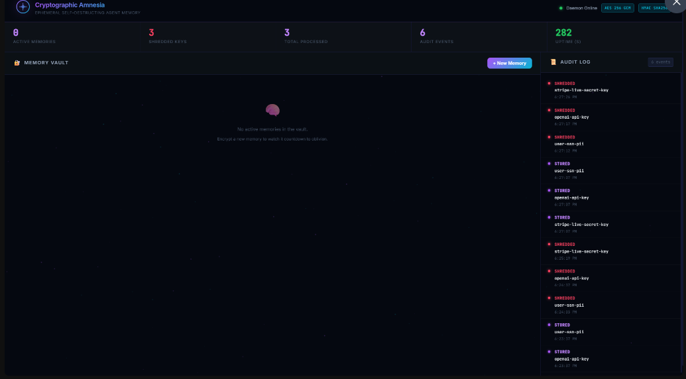

# Aegis-Amnesia

> A TypeScript in-memory vault for AI agents: each secret is encrypted with its own AES-256-GCM key, and that key is zeroed when the TTL expires, so the vault can no longer decrypt the secret.

**Status:** Prototype, solo project. 46 Vitest tests pass (`npm test`, checked on the PR #1 branch). The HTTP daemon is for local use only.
**Demo:** none hosted. `npm run demo` runs a local scripted example; the dashboard screenshot is below.



## Quickstart

Requires Node.js 20 or newer (Vitest 4 needs it).

```bash
git clone https://github.com/HamzaKhanBUIC/aegis-amnesia.git
cd aegis-amnesia
npm ci
npm test        # Vitest suite
npm run demo    # stores a value, reads it, waits for the 3 s TTL, then shows the read fail
```

Library use (these are the real signatures in `src/vault.ts`):

```typescript
import { AmnesiaVault } from './src/vault';

const vault = new AmnesiaVault();
const id = vault.store('OPENAI_API_KEY', 'example-secret', 60_000); // label, plaintext, ttlMs
vault.retrieve(id);   // plaintext, or null once the key is shredded
vault.shred(id);      // zero the key now; returns a signed shred receipt, or null if already shredded
```

### HTTP daemon and dashboard

```bash
cp .env.example .env              # then set AMNESIA_TOKEN
npx tsx --env-file=.env src/server.ts
```

The daemon listens on `127.0.0.1:3747` by default and serves the dashboard at `/index.html`. It refuses to start unless `AMNESIA_TOKEN` is set to at least 16 characters. Every `/memory*` and `/audit*` request needs `Authorization: Bearer <AMNESIA_TOKEN>`. `/health` and the dashboard files do not. The dashboard asks for the token in a prompt and keeps it in `sessionStorage`.

| Route | Purpose |
| :-- | :-- |
| `GET /health` | Status and counts, no auth |
| `POST /memory/store` | Body `{label, plaintext, ttlMs}`; `ttlMs` up to 24 h; JSON body limit 16 kB |
| `GET /memory` | List active records (no keys or ciphertext) |
| `GET /memory/:id` | Decrypt and return the plaintext, 404 if shredded |
| `DELETE /memory/:id` | Shred now, returns the shred receipt |
| `GET /audit/log`, `GET /audit/stats` | Audit events and counts |

## Configuration

| Variable | Required | Default | Description |
| :-- | :-- | :-- | :-- |
| `AMNESIA_TOKEN` | yes, for the daemon | none | Bearer token, 16 characters or more. Generate with `openssl rand -hex 32`. |
| `HOST` | no | `127.0.0.1` | Interface to bind. Setting it to anything else exposes plaintext retrieval to that network and logs a warning. |
| `PORT` | no | `3747` | Port to listen on. |
| `AMNESIA_URL` | no | `http://127.0.0.1:3747` | Daemon URL used by `examples/populate.ts`. |

## What zeroization does and does not cover

- **Covered:** the per-record 256-bit key (`crypto.randomBytes(32)`) is overwritten with zeros (`key.fill(0)`) on TTL expiry or `shred`. After that the vault cannot decrypt the record. This is crypto-shredding.
- **Not covered:**
  - Plaintext enters and leaves as JavaScript strings. Strings are immutable and cannot be wiped.
  - The decrypted `Buffer` and the HTTP JSON body are not cleared.
  - OpenSSL keeps its own copies of keys inside cipher and HMAC contexts until they are garbage collected.
  - Anything a caller already received is out of scope.
- **TTL:** it is fixed from the time of `store`. Reading a record does not extend it.
- **Shred receipt:** the "proof of erasure" is an HMAC, made with a per-process key, over the record ID, a SHA-256 of the key and a time. It shows the vault logged a shred. It is not proof about memory contents.

## Limitations

- Prototype. No forward secrecy (there is no key exchange) and no persistence: records live in process memory only.
- Uses Node's `node:crypto`, not the browser Web Crypto API.
- Errors do not trigger a shred. A failed decrypt is logged as `SHRED_FAILED` and the record stays.
- Shredded records stay in memory as ciphertext plus a zeroed key. There is no record cap or rate limit.
- The same key is used for AES-GCM and for an extra HMAC; `verifyErasure` compares with `===`.
- `docs/` holds two short stubs, not a threat model.
- `examples/` has a Node demo and a populate script; there is no LangChain integration.

## License

MIT. See [LICENSE](LICENSE).

